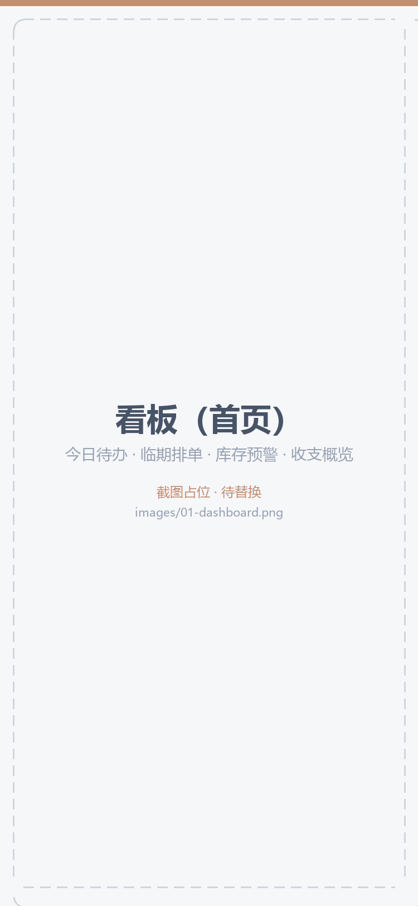
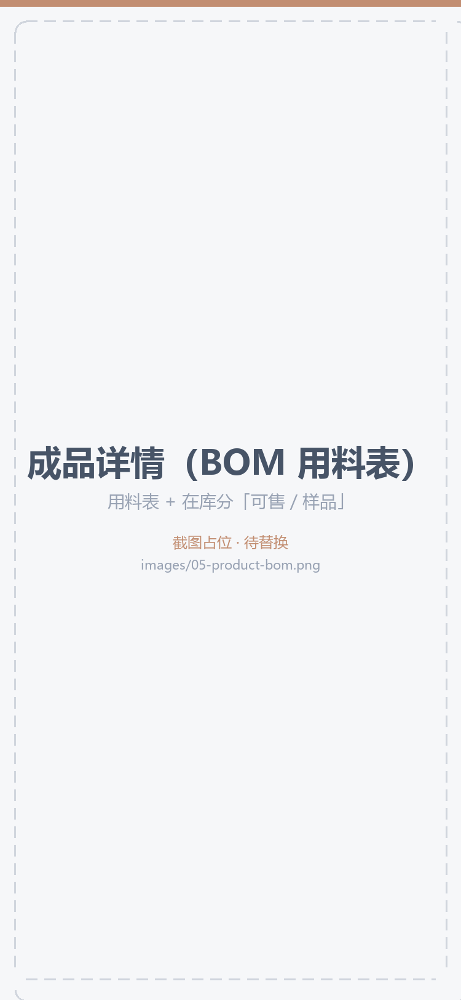
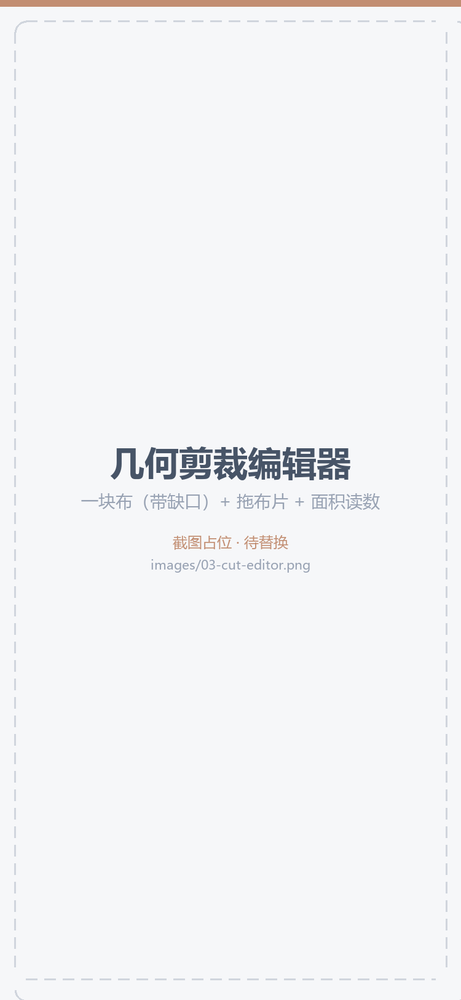
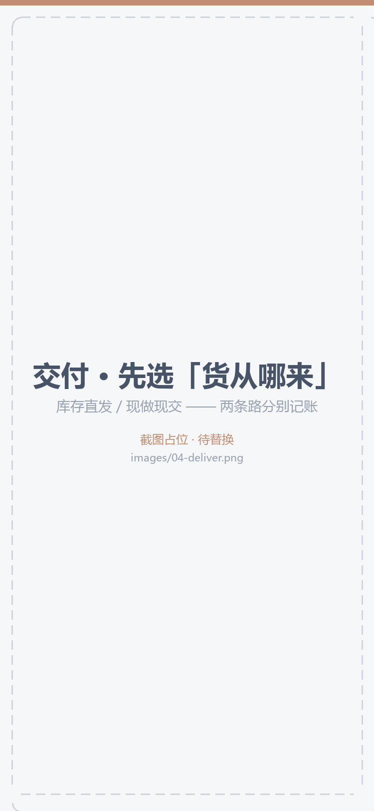

# 别针手作库

> 一个**纯本机运行**的微信小程序：给手工创作者管理「物料 → 成品 → 排单交付」的全链路与账目。
> 数据全部存在手机本机，**零网络请求、零位图资源、无需登录、无后端**。

| 项 | 值（都可用脚本复跑） |
|---|---|
| 页面 | **37 个**（底部 4 个页签：看板 / 物料库 / 作品集 / 我的） |
| 测试 | **1197 条全绿** —— `node tests/run.js` |
| 代码规模 | 业务 30,057 行（`js/wxml/wxss/json`）／测试 21,867 行 |
| 开发过程 | **172 次提交 / 164 个版本标签**（`V1`…`V155`，2026-09-11 起 34 天）—— 对外展示仓是**干净快照**，不含这段历史 |
| 主包体积 | 221 文件 / **1.46 MB** —— `node tools/pkg-size.js` |
| 第三方依赖 | **0**（没有 `package.json`，连 XLSX 导出都是自己写的） |

<p align="center">
  
  
</p>
<p align="center"><sub>看板 · 物料库</sub></p>

---

## 它解决什么问题

做手工小生意（缝纫 / 拼豆 / 粘土 / 钩织 / 串珠）的人，账最容易乱在三件事上：

1. **物料**：一块布买了多少米、剩多少、这次是从**哪一块布**上裁下来的；
2. **在库**：做好的成品有几件能卖、几件是自己留的样品；
3. **交付**：客户排单交了几件 —— 而且交出去的这批货是「**从库存里拿的**」还是「**现做现交的**」，
   这两件事的账**完全不同**。

本项目把这三笔账分开记，并且要求它们**对得上**。

---

## 功能概览

| 模块 | 内容 |
|---|---|
| **看板** | 今日待办、临期排单、库存预警、收支概览 |
| **物料库** | 按**手作空间**隔离分类（缝纫 / 拼豆 / 粘土 / 钩织 / 串珠，可自建）；多维度属性（颜色 / 材质 / 规格…）；批量入库；出库与撤销 |
| **作品集** | 成品 **BOM（用料表）**；在库分「可售 / 样品」；生产与销售流水；**几何剪裁编辑器**（按布片形状与面积扣料） |
| **排单交付** | 客户排单 → 交付时**先选「货从哪来」**（库存直发 / 现做现交），两条路分别记账；误操作可撤销并对账回滚 |
| **我的** | 手作空间切换、**6 套主题**、出厂预设管理、账本、损耗登记、数据备份与导出（自研 XLSX）、体检与隐私说明 |

---


<p align="center">
  
  
</p>
<p align="center"><sub>成品详情（BOM 用料表） · 累计总账明细</sub></p>

## 技术上有意思的几处

### 1 · 纯本机，但把「能接云」做成了一份工程判断

- 业务代码里 `wx.request` 出现 **0 次** —— 而且这一点是**被测试钉住的**：测试用的 `wx-stub` 里
  `request()` 直接抛错（"未预期的 wx.request 调用：本项目应为零网络架构"），
  `tests/smoke.test.js` 专门断言"调用 `wx.request` 必须抛错"，防止以后有人顺手引入网络依赖。
- **小程序包内没有任何图片资源** —— 界面全部由样式与矢量绘制：没有照片时，缩略图是
  「**按分类取色的色块 + 名称首字**」（`utils/palette.js` 按分类下标取色 + `.std-thumb`）；
  用户自己拍的照片也只存在本机，不上传。
  （本 README 里的截图放在 `images/`，已在 `project.config.json` 的 `packOptions.ignore` 里排除，**不进小程序包**。）
- 云开发能力（云函数、云备份、图片上云）**代码都写了**，但**总闸是关的**：`services/cloud-config.js` 里
  `ENV_ID = '__disabled__'` ⇒ `isEnabled()` 返回 `false` ⇒ 云模块完全不初始化，**零云开销**。
- 立过的硬要求：**云未配置或运行环境不支持时，必须完整降级为纯本地** ——
  「接了云」绝不能比「不接云」更差，所有云调用方都要先问 `isEnabled()`。

### 2 · 布料几何内核：按形状与面积扣料

`utils/sheets.js`（311 行，纯函数、零依赖）：把一块布当几何面处理 —— 按**布片形状与面积**排布与扣减、
FIFO 取片、**逐件选择**从哪一块布的哪个位置裁（来源可溯源）。

> 与「数量 × 固定用量」的粗算法相比，它解决的是"这块布裁完还剩多少、下次还能不能再用"。


<p align="center">
  
</p>
<p align="center"><sub>几何剪裁编辑器：一块布（带缺口）→ 拖布片 → 按面积扣料</sub></p>

### 3 · 账务口径：交付先问「货从哪来」

同一个「交付 N 件」，两条路的账完全不同：

| 来源 | 在库 | 销售流水 | 物料 |
|---|---|---|---|
| 从**成品在库**出 | −N | 写 | **不动**（料在生产时已经扣过） |
| 从**物料出现做现交** | +N 再 −N | 写 | 按你**逐件选的裁剪方案**扣一次 |

需要裁剪的面料行如果没带裁剪方案，系统**直接拦下**，绝不静默替用户决定从哪块布上裁。

> 📌 这里踩过一个值得说的坑：老版本交付走的是「系统按面积自动刨布」——
> 账上**有记录**，但**那个决定是系统做的、不是用户做的**。
> **「有记录」≠「有决定」** —— 审计自动化动作时要问的是"这个决定谁做的"，而不是"它留痕了吗"。


<p align="center">
  
</p>
<p align="center"><sub>交付前先选「货从哪来」：库存直发 / 现做现交</sub></p>

### 4 · 主题体系：6 套配色，但配色不能凭眼睛

每套主题 = **13 个 token** + 12 个由 `roles()` 派生的**角色变量**（色带 / 胶囊 / 圆形加号 / 点睛卡 / 数字…）。
配色必须过一组**硬判据**（写进测试逐条断言）：

- 主色上的字色对比度 ≥ **2.8**；卡面与页面底的明度差 ≥ **0.035**
- 撞色主题额外要求「主色在页面底与卡面上都 ≥ **4.5**」
- 色板给的每一支颜色都要有落点（一个不剩）

> 📌 最近一次需求是「红黄都稍微淡一点」—— 这看着是审美，实际是**约束题**：
> 红变亮会同时抬高「主色 / 页面底」的分子与分母、黄变亮会吃掉卡面与底的明度差。
> 做法是**先写探针脚本扫边界**（算出"红再淡两档就跌破 4.5"），再定值，并把边界钉成一条测试。


<p align="center">
  
</p>
<p align="center"><sub>同一页面 · 6 套主题（可随时切换）</sub></p>

### 5 · 工程质量：测试不只是"跑一遍"

- **1197 条测试**：账目、迁移、组件、页面行为。测试与工具脚本是**纯 Node + 自带的 `wx-stub`**，
  克隆下来 `node tests/run.js` 就能跑，不需要装任何依赖。
- **结构守卫（guard）**：把「必须成组改动」的东西列成**清单**逐个断言 ——
  往清单里加新东西时必须改清单，等于**逼作者显式做一个决定**。
- **变异注入自检（本项目的叫法：验牙）**：往源码里注入"退回老写法"的破坏，确认守卫**真的会红、
  而且红在对的地方**（不是随手红一条、也不是假绿）。
- **迁移体系**：`SCHEMA_VERSION` + 一次性迁移。出厂预设只对新装生效，老用户靠迁移补齐
  （只加不删 / 按 id 或同空间同名认 / 只补一次）。
- **体积纪律**：主包 1.46 MB；`node tools/pkg-size.js` 可随时复跑。
- **可追溯**：每次改动都有版本号、日期、影响范围与验证结论（版本标签 `V1`…`V155`）。

### 6 · 零依赖的几个后果

因为没有第三方库：XLSX 导出是**自己写的最小生成器**（`utils/xlsx.js`，239 行 —— 引一个库会挤占
小程序 2MB 主包上限）、CSV / 图表 / 日期处理 / 颜色体系也全部自研。好处是包体小、可控、可测；
代价是这些轮子得自己保证正确性（所以它们都有测试）。

---

## 目录结构

```
handmade-inventory/
├── app.js / app.json / app.wxss        # 全局：生命周期、页面与页签配置、全局样式
├── pages/                              # 37 个页面（按功能分子目录）
│   ├── dashboard/  materials/  products/  commission/  mine/
│   ├── cut-editor/                     # 几何剪裁编辑器
│   ├── inspiration/  want/  loss/  ledger/
│   └── settings/                       # 分类 / 预设 / 历史 / 账单 / 备份 / 导出 / 体检 …
├── components/                         # 自定义组件（左滑单元格、弹窗、日期/选择器、折线图…）
├── services/                           # 业务服务与基础设施
│   ├── storage.js  state.js  keys.js   # 存储抽象 / 全局状态 / 存储键
│   ├── migrations.js                   # 数据迁移（SCHEMA_VERSION）
│   ├── presets.js                      # 出厂预设的唯一源（纯数据）
│   ├── valuation.js  trace.js  loss.js # 估值 / 全链路追溯 / 损耗
│   └── cloud*.js  backup.js            # 云能力（当前未启用，保留实现）
├── utils/                              # 领域内核与工具
│   ├── store.js                        # 数据访问层（唯一的读写入口）
│   ├── calc.js                         # 账目纯函数
│   ├── sheets.js                       # 布料几何内核
│   ├── themes.js                       # 主题表（6 套）
│   ├── deliver-flow.js                 # 交付流程（两个入口共用）
│   └── xlsx.js  csv.js  stat*.js       # 自研导出与统计
├── images/                             # README 截图（不进小程序包：packOptions.ignore 已排除）
├── tests/                              # 1197 条测试（纯 Node，含 wx-stub 与结构守卫）
├── tools/                              # 包体统计、隐私清单等脚本
└── cloudfunctions/                     # 云函数（当前未部署/未启用）
```

---

## 本地跑起来

```bash
# 1. 测试（纯 Node，无需安装依赖）
node tests/run.js

# 2. 主包体积
node tools/pkg-size.js

# 3. 用微信开发者工具「导入项目」选择本目录
#    ⚠️ AppID 请换成你自己的（仓库里带的是开发用 AppID）
```

> 代码里**没有任何网络请求**，导入后断网也能完整使用。

---

## 几点说明

- 单人**从 0 到 1** 独立开发；无后端、无登录，数据全在本机。
- 云开发 / 图片上云能力**保留了实现但当前未启用**；二期 AI 能力**未开发**；图文教程入口目前**隐藏**。
- 仓库中的 AppID 为开发用 AppID，导入时替换为你自己的即可。
- 界面主题、预设清单等界面相关数字均由脚本生成，不手抄。

## 许可

暂未声明开源许可（默认保留所有权利）。如需引用或使用，请先联系我。
